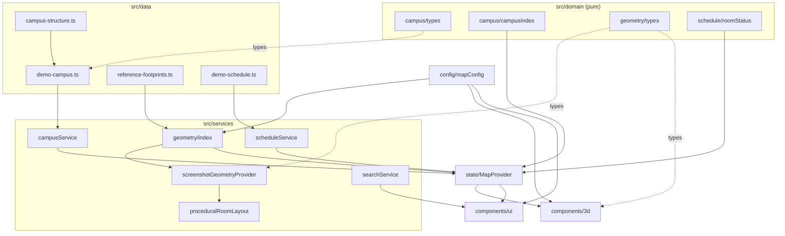
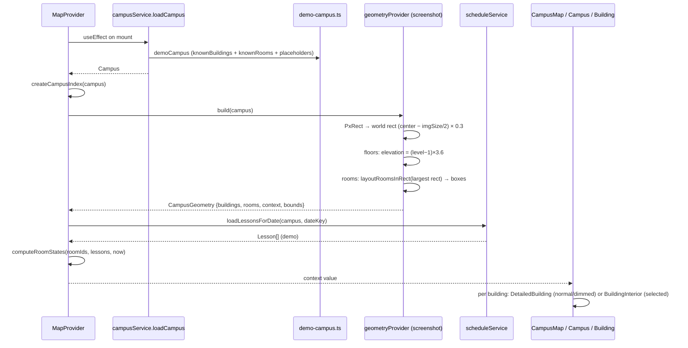
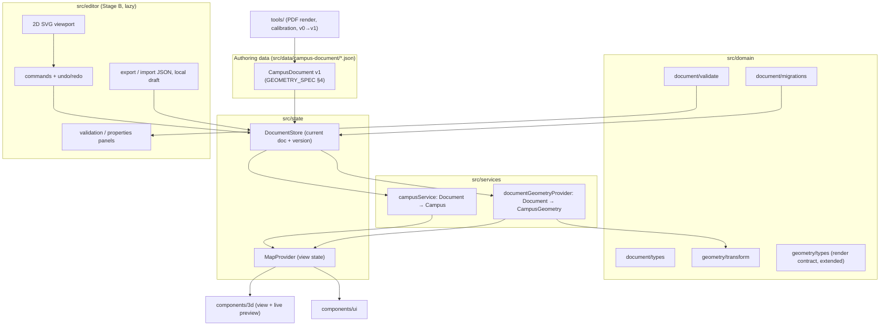

# ARCHITECTURE — архитектура системы

> Состояние на ветке `feature/detailed-c-block`, коммит `01c4265` (2026-10-07). Аудит проведён 2026-10-14.
> Метки: **[факт]** — подтверждено кодом; **[предложение]** — целевая архитектура (см. статусы в [DECISIONS.md](DECISIONS.md)); **[?]** — неизвестно.
> Форматы данных, координаты и ID здесь **не определяются** — это задача [GEOMETRY_SPEC.md](GEOMETRY_SPEC.md).

---

## 1. Стек и точки входа [факт]

| Слой | Технология (версия из `package.json`) |
|---|---|
| Сборка / dev-сервер | Vite `^8.3.3`, `@vitejs/plugin-react`, `@vitejs/plugin-basic-ssl` (dev на HTTPS, `host: true` — для тестов с телефона) |
| Язык | TypeScript `^7.0.2`, `strict: true`, `noEmit`, `moduleResolution: bundler`, `resolveJsonModule: true` |
| UI | React `^19.3.0` |
| 3D | three `^0.186.1`, `@react-three/fiber ^9.8.1`, `@react-three/drei ^10.7.9` |
| Тесты | vitest `^5.0.3` — **тестовых файлов нет**, `npm test` завершается с кодом 1 («No test files found») |
| Линтер | не настроен (в `MapProvider.tsx` есть комментарий `eslint-disable`, но eslint не установлен) |
| Бэкенд | отсутствует; все данные — статические TS-модули |

Скрипты: `dev`, `build` (`tsc --noEmit && vite build`), `preview`, `typecheck`, `test`. На момент аудита `npm run typecheck` проходит (код 0). `build` не запускался, потому что `dist/` отслеживается git и изменился бы.

Цепочка входа: `index.html` → [`src/main.tsx`](../src/main.tsx) → [`src/App.tsx`](../src/App.tsx) → `MapProvider` → `AppLayout` (`CampusMap` + боковая панель).

---

## 2. Модули [факт]

```text
src/
  domain/                      чистые типы и функции, без React/three
    campus/types.ts            Campus, Building, Floor, Room, RoomKind, DataProvenance
    campus/campusIndex.ts      createCampusIndex, sortedFloors, defaultFloor
    geometry/types.ts          render-контракт: CampusGeometry, BuildingGeometry, RoomGeometry, Footprint, CampusGeometryProvider
    schedule/types.ts          Lesson, RoomStatus, RoomScheduleState
    schedule/roomStatus.ts     computeRoomState(s) — чистая логика статусов
  data/                        источники данных (TS-литералы)
    campus-structure.ts        knownBuildings (10 зданий bld-a…bld-j, floorCount), campusInfo
    demo-campus.ts             сборка Campus: комнаты из расписания + демо-заглушки
    reference-footprints.ts    прямоугольники зданий и контекста в пикселях
    demo-schedule.ts           детерминированное фейковое расписание
  config/mapConfig.ts          все «магические числа»: масштаб, высоты, камера, цвета
  services/
    campus/campusService.ts    loadCampus() → demoCampus (async-обёртка)
    geometry/index.ts          ЕДИНСТВЕННАЯ точка выбора провайдера геометрии
    geometry/screenshotGeometryProvider.ts   px → метры, процедурные комнаты
    geometry/proceduralRoomLayout.ts         layoutRoomsInRect
    schedule/scheduleService.ts loadLessonsForDate, toLocalDateKey, formatTime
    search/searchService.ts    search(query, index, lessons)
  state/MapProvider.tsx        React-контекст: данные, геометрия, выбор, время
  hooks/useNow.ts              live / simulated время
  components/3d/               сцена R3F
  components/ui/               DOM-панель
```

### 2.1 Зависимости модулей



Направление зависимостей соблюдается: `domain` ни от чего не зависит, компоненты не импортируют `data/` напрямую. **Исключение-нарушение:** `ContextLayer.tsx` хардкодит ID зданий `'bld-g'` и `'bld-d'` для расчёта ворот ограды.

---

## 3. Поток данных: от источника геометрии до 3D [факт]



Ключевые свойства:
- Геометрия строится **один раз** при загрузке (`geometryProvider.build` внутри `useEffect([])`). Механизма обновления геометрии во время работы нет — это нужно добавить для этапа B.
- `CampusGeometry` — обычные сериализуемые структуры в **мировых** координатах. Рендер не знает об источнике данных.
- Комнаты связаны с геометрией только по `room.id` (`geometry.rooms[room.id]`).

---

## 4. 3D-сцена [факт]

| Компонент | Роль | Замечания |
|---|---|---|
| [`CampusMap.tsx`](../src/components/3d/CampusMap.tsx) | `<Canvas shadows>`, свет, `Sky`, `Environment preset="city"`, `SoftShadows`, слои | `Environment preset` загружает HDRI с `raw.githack.com` (подтверждено в `drei/core/useEnvironment.js`) — **сетевая зависимость**, офлайн не проверялся |
| [`Campus.tsx`](../src/components/3d/Campus.tsx) | цикл по зданиям; режим `normal` / `dimmed` / `interior`; счётчик live-уроков | — |
| [`Building.tsx`](../src/components/3d/Building.tsx) | `BuildingMass` → `DetailedBuilding`; `BuildingInterior` → прозрачная оболочка + `Floor` для этажей ≤ выбранного | — |
| [`DetailedBuilding.tsx`](../src/components/3d/DetailedBuilding.tsx) | стили по `switch(building.id)`, стены, цоколь, окна (InstancedMesh), вальмовые и плоские крыши, карнизы | см. техдолг TD-3…TD-5 |
| [`Floor.tsx`](../src/components/3d/Floor.tsx) | плита по контуру здания + комнаты активного этажа | — |
| [`Room.tsx`](../src/components/3d/Room.tsx) | box или polygon, цвет по статусу, HTML-ярлык-кнопка | — |
| [`ExtrudedFootprint.tsx`](../src/components/3d/ExtrudedFootprint.tsx), [`geometryUtils.ts`](../src/components/3d/geometryUtils.ts) | общие примитивы выдавливания, `footprintOutline`, `roomCenter/roomTop` | конвенция поворота — [GEOMETRY_SPEC §1.7](GEOMETRY_SPEC.md#17-поворот--расхождение-конвенций) |
| [`ContextLayer.tsx`](../src/components/3d/ContextLayer.tsx) | земля, ограда с воротами, плоские слои контекста, структуры | ограда строится по `bounds`, не по данным |
| [`Vegetation.tsx`](../src/components/3d/Vegetation.tsx) | 150 деревьев (InstancedMesh) случайно в газонах | `Math.random` — недетерминировано; деревья могут попадать на здания и дорожки |
| [`ReferenceOverlay.tsx`](../src/components/3d/ReferenceOverlay.tsx) | спутниковый снимок на земле (тумблер в UI) | на этой ветке не совпадает с footprints (GEOMETRY_SPEC §1.2) |
| [`CameraController.tsx`](../src/components/3d/CameraController.tsx) | `CameraControls`, кадрирование по выбору | — |
| [`BuildingLabel.tsx`](../src/components/3d/BuildingLabel.tsx), [`pointer.ts`](../src/components/3d/pointer.ts) | ярлыки зданий; `isClick` (≤ 5 px — клик, больше — перетаскивание камеры) | — |
| [`BuildingMaterials.ts`](../src/components/3d/BuildingMaterials.ts) | canvas-текстура окон | **нигде не импортируется** (мёртвый код) |

---

## 5. Выбор, этажи, поиск, навигация [факт]

- **Состояние выбора** — `Selection = { buildingId?, floorId?, roomId? }` в `MapProvider`. Методы: `selectBuilding` (автоматически выбирает `defaultFloor`: `level === 1` или самый нижний), `selectFloor`, `selectRoom`, `clearSelection`.
- **Выбор в 3D:** клик по `DetailedBuilding` или `BuildingLabel` → `selectBuilding`; клик по `Room` или его ярлыку → `selectRoom`. Перетаскивание камеры кликом не считается (`isClick`). Hover — только визуальная подсказка (правило README: не полагаться на hover).
- **Этажи:** [`FloorSelector`](../src/components/ui/FloorSelector.tsx) поверх сцены. В режиме `interior` рисуются плиты всех этажей ≤ выбранного, комнаты — только у выбранного.
- **Поиск:** [`searchService.search`](../src/services/search/searchService.ts) ищет подстроку в нормализованном тексте (`room.number`, `room.name`, затем предмет/преподаватель/группа уроков), максимум 25 результатов. [`SearchBox`](../src/components/ui/SearchBox.tsx) по клику вызывает `selectRoom`.
- **Навигация:** есть только навигация камеры (`CameraController.framing`) и хлебные крошки ([`Breadcrumbs`](../src/components/ui/Breadcrumbs.tsx)). **Маршрутизации и поиска пути нет**, графа проходов нет. URL-состояния (deep links) нет.
- **Время:** `useNow` в режиме live или simulated (слайдер); `computeRoomStates` пересчитывает статусы.

---

## 6. Ограничения и технический долг [факт]

| ID | Проблема | Где | Влияние на этапы |
|---|---|---|---|
| TD-1 | ID комнат формируются по индексу (`-r${i+1}`) | `demo-campus.ts` | A: ID нужно заморозить до импорта ([GEOMETRY_SPEC §5.3](GEOMETRY_SPEC.md#53-совместимость-со-старыми-id)) |
| TD-2 | Комнаты раскладываются только в самом большом прямоугольнике здания | `screenshotGeometryProvider.ts` | A: заменяется данными плана |
| TD-3 | Хук `useExtrudedGeometry` вызывается внутри `.map()` — нарушение rules of hooks; работает, пока число частей не меняется | `DetailedBuilding.tsx` | **B: сломается** при добавлении/удалении частей в редакторе |
| TD-4 | `Windows` создаёт `InstancedMesh`, материал и геометрию на каждом рендере без `dispose` — утечка GPU-памяти | `DetailedBuilding.tsx` | B (частые перерисовки), C |
| TD-5 | Стили зданий захардкожены `switch(building.id)`; крыши и окна строятся по bbox частей | `DetailedBuilding.tsx` | C; искажения на полигональных и повёрнутых частях |
| TD-6 | Ограда привязана к литералам `'bld-g'`, `'bld-d'` и к `bounds` | `ContextLayer.tsx` | B/C |
| TD-7 | Растительность недетерминирована (`Math.random`), игнорирует здания и дорожки | `Vegetation.tsx` | C |
| TD-8 | HDRI загружается из внешнего CDN | `CampusMap.tsx` | C: офлайн и стабильность |
| TD-9 | Footprints `01c4265` не совпадают с `campus.jpg`; `imageSizePx`/`metersPerPixel` относятся к старой раскладке | `reference-footprints.ts`, `mapConfig.ts` | A: блокирует калибровку (Q2) |
| TD-10 | Противоречивые названия зданий (комментарии vs `campus-structure.ts`); `shortName 'C'` у трёх зданий | `data/*`, `DetailedBuilding.tsx` | A: сопоставление PDF ↔ здание (Q3) |
| TD-11 | Конвенции поворота в `footprintOutline` и `Room` противоположны | `geometryUtils.ts`, `Room.tsx` | A/B, как только появится `rotation` |
| TD-12 | Геометрия строится один раз, реактивного обновления нет | `MapProvider.tsx` | B: синхронизация 2D ↔ 3D |
| TD-13 | Тестов нет; `npm test` падает | — | все этапы |
| TD-14 | `node_modules/` и `dist/` закоммичены, `.gitignore` нет | корень | шумные диффы, конфликты между агентами |
| TD-15 | Неотслеживаемый **пустой файл** `scripts` в корне не даёт создать каталог `scripts/` | корень | A: инструменты импорта (ADR-019) |
| TD-16 | README устарел: описывает ветку `experiment/detailed-buildings` с единым 4-этажным C-блоком, а на этой ветке C — три здания по 2 этажа; ветки `experiment/detailed-buildings` нет ни локально, ни на `origin` | `README.md` | путаница для агентов |
| TD-17 | Текст `DataNotice` («traced approximately from satellite imagery») не соответствует раскладке `01c4265` | `MapControls.tsx` | A |

---

## 7. Целевая архитектура после этапов A–C [предложение]



Основные идеи:
1. **Документ** — единственный источник геометрии и метаданных помещений (ADR-005). Литералы в `data/*.ts` заменяются им после миграции v0→v1.
2. **`DocumentStore`** хранит текущий документ с номером ревизии. `MapProvider` пересчитывает `Campus`, `CampusIndex` и `CampusGeometry` мемоизированно по ревизии; так устраняется TD-12.
3. **Редактор** (этап B) меняет документ **только через команды** (ADR-014). 3D-сцена видит те же изменения через store — синхронизация достигается одной моделью данных, без двустороннего связывания.
4. **Render-контракт** `CampusGeometry` расширяется аддитивно: добавляются `floorPlans` (стены, проёмы, пространства без room, вертикали), `connectors` (межкорпусные переходы, ADR-020), `precision: 'plan'` (ADR-003, ADR-007).
5. **Внешний вид** (этап C) задаётся данными (`BuildingDoc.appearance`), а не `switch` по ID (ADR-015).

---

## 8. Границы изменений

### 8.1 Можно менять независимо (в рамках своей задачи, без ADR)

- Внутренности отдельного 3D-компонента при неизменных props и контракте (например, материалы в `DetailedBuilding`, свет в `CampusMap`).
- Стили (`src/index.css`) и UI-компоненты, если `MapContextValue` не меняется.
- Значения в `mapConfig.ts`, **кроме** `reference.*`, `building.floorHeight`, `building.slabThickness`, `roomLayout.*`: они влияют на геометрию и ID-совместимость (миграция v0→v1).
- Данные одного здания (`buildings/<id>.json`) в рамках назначенной задачи, если проходит валидатор.
- Новые тесты.

### 8.2 Требуют согласованного изменения (ADR + обновление документов)

| Что | Почему | Документы |
|---|---|---|
| `src/domain/geometry/types.ts` (render-контракт) | от него зависят провайдеры, все 3D-компоненты, `RoomDetails`, `CameraController` | GEOMETRY_SPEC §4.3, ARCHITECTURE §7, DECISIONS (ADR-020) |
| `src/domain/campus/types.ts` | поиск, расписание, UI, индекс | ARCHITECTURE, GEOMETRY_SPEC §5.4 |
| Формат `CampusDocument`, `schemaVersion`, миграции | данные, редактор, провайдер | GEOMETRY_SPEC §4, §9 |
| Системы координат, `yaw`, datum, единицы | всё | GEOMETRY_SPEC §3 |
| Форматы ID и правила стабильности | расписание, сохранённые данные | GEOMETRY_SPEC §5 |
| `MapContextValue` / `Selection` | все компоненты | ARCHITECTURE §5 |
| Выбор провайдера в `services/geometry/index.ts` | переключение источника правды | IMPLEMENTATION_PLAN A4 |
| Новые runtime-зависимости в `package.json` | размер бандла, совместимость | DECISIONS |

---

## 9. Архитектурное разделение слоёв и визуальная подсистема (Этап C) [факт]

В кодовой базе строго разделены три уровня ответственности:

1. **Слой геометрии и пространственных данных** (`domain/geometry/`, `services/geometry/`):
   - Оперирует контурами (`Footprint`), высотами, координатами комнат и стен.
   - Не содержит информации о текстурах, материалах, палитрах или декоративных фасадах.
2. **Слой схемы и структуры кампуса** (`domain/campus/`, `editor/domain/`):
   - Оперирует сущностями кампуса: здания, этажи, помещения, идентификаторы, вместимость, связи с расписанием.
   - Гарантирует стабильность ID и бизнес-метаданных.
3. **Слой визуального представления** (`domain/appearance/`, `components/3d/`):
   - Конфигурации стилей (`BuildingAppearance`): цвет и шероховатость стен, типы крыш (`hip`, `flat`), парапеты, цоколь, окна, порталы входов, витражные вставки.
   - Стили задаются через декларативные пресеты (`academic-classic`, `academic-modern`, `dormitory`, `sports-complex`, `utility`, `default`).
   - Функция `getBuildingAppearance(building)` обеспечивает безопасный фоллбэк: отсутствие визуальных настроек никогда не ломает рендеринг.
   - Окружение (`Vegetation.tsx`, `ContextLayer.tsx`): детерминированная генерация растительности по фиксированному seed без коллизий со зданиями.
   - Освещение (`CampusMap.tsx`): мягкие тени `PCFSoftShadowMap`, физический `Sky`, отказ от внешних CDN HDRI (ADR-018).

---

## 10. Архитектура 2D Visual Editor (`src/editor/`) [факт]

2D-редактор (`src/editor/`) построен как визуальный графический редактор со светлой (white) темой и строгим разделением пяти уровней ответственности:

1. **Семантическая схема данных (`src/editor/domain/types.ts`, `adapter.ts`)**:
   - Единый документ `EditorDocument` (`schemaVersion: 1`) хранит здания (`EditorBuilding`, включая многосекционные крылья `parts`), этажи (`EditorFloor`), внутренние элементы этажей (`EditorRoom` с `elementType`: `room`, `corridor`, `hall`, `lobby`, `door`, `window`, `stairs`, `elevator`, `entrance`, `exit`, `wall`, `partition`, `custom`, поддержкой прямоугольников и полигонов `polygon`) и внешние элементы кампуса (`EditorOutdoorElement`: `path`, `walkway`, `road`, `lawn`, `tree`, `plaza`, `fountain`, `entrance`, `custom`).
   - Каждый объект поддерживает стабильный `id`, `name`, `description`, `customMetadata` и поле **`aiComment` ("Instructions for AI")** для описания желаемых правок на естественном языке.
   - Преобразование координат: мировые метры `[wx, wz]` (`+X` = Восток, `+Z` = Юг) напрямую отображаются на 2D-холст (`screenX = pan.x + wx * zoom`, `screenY = pan.y + wz * zoom`). Координаты элементов этажа `localCenter: [lx, lz]` хранятся относительно центра родительского здания `building.footprint.center`, поэтому перемещение здания сохраняет его внутреннюю планировку и все секции `parts`.
2. **Состояние и прямое манипулирование на холсте (`src/editor/components/EditorCanvas.tsx`, `EditorPage.tsx`, `history/`)**:
   - Прямое манипулирование мышью/тачем: выбор кликом, множественный выбор (`Shift+Click` и рамка выделения marquee), перетаскивание, изменение размеров за 8 маркеров (`nw`, `n`, `ne`, `e`, `se`, `s`, `sw`, `w`), редактирование вершин полигонов и полилиний дорожек, рисование прямоугольников перетаскиванием и пошаговое рисование полигонов/дорожек, привязка к сетке, направляющие выравнивания (smart alignment guides) и переименование двойным кликом.
   - Переключатель этажей (`Floor 1`, `Floor 2`, ... `+ Floor`) на холсте и в боковой панели, а также переключаемые слои кампуса (`buildings`, `paths`, `greenery`, `infrastructure`, `annotations`).
   - Все мутации проходят через `SnapshotCommand` и `HistoryManager` (`Undo` / `Redo`) с автоматическим сохранением черновика (`saveDraft`) в IndexedDB / `localStorage`.
3. **Генерация 3D-геометрии и синхронизация (`src/editor/domain/adapter.ts`, `src/services/campus/campusService.ts`)**:
   - Функция `editorDocToCampusAndGeom(doc)` преобразует `EditorDocument` обратно в `Campus`, `buildingFootprintsPx`, `roomOverrides` и `contextFeaturesPx`, которые подхватываются `MapProvider` и `screenshotGeometryProvider` без дублирования состояния.
4. **Отслеживание изменений и индивидуальный откат (`src/editor/changeTracking/changeTracker.ts`)**:
   - `computeSemanticChanges(baselineDoc, currentDoc)` вычисляет семантический дифф относительно исходного состояния кампуса по категориям: `added`, `modified`, `moved`, `resized`, `renamed`, `deleted` (включая удалённые объекты, отображаемые пунктирным контуром в режиме `Review Changes`).
   - `revertIndividualChange(currentDoc, baselineDoc, change)` позволяет откатить или восстановить любой отдельный объект без потери остальных правок.
5. **Фото-вложения и визуальные референсы (`src/editor/storage/attachmentStorage.ts`, `src/editor/components/PhotoAttachmentsSection.tsx`)**:
   - Каждый объект кампуса (`EditorDocument`, `EditorBuilding`, `EditorFloor`, `EditorRoom`, `EditorOutdoorElement`) поддерживает массив метаданных `photos?: PhotoAttachment[]` (`id`, `fileId`, `fileName`, `mimeType`, `byteSize`, опциональные `title`, `caption`, `aiInstruction`, `direction`, `order`).
   - Бинарные изображения (JPEG, PNG, WebP и др.) хранятся **отдельно** от `EditorDocument` и `geometry.json` в специализированном хранилище `attachmentStorage.ts` (IndexedDB `CampusMapAttachmentsDB` + синхронный кэш предпросмотра и безопасный фоллбэк), что исключает раздувание JSON-документа строками base64 и гарантирует сохранность связей при перемещении, изменении размеров или переименовании объектов, а также после перезагрузки страницы.
6. **AI-friendly ZIP экспорт (`src/editor/export/exportService.ts`, `zipWriter.ts`)**:
   - Формирует самодостаточный архив `campus-edit-*.zip` (схема `1.0.0`) без внешних runtime-зависимостей с выбором охвата референсов (`referenceScope: 'all' | 'changed-only'`):
     - `campus-edit/manifest.json` — версия схемы, система координат, единицы измерения, статистика правок, реестр прикреплённых фото-референсов и список файлов;
     - `campus-edit/instructions.md` — человеко- и AI-читаемая сводка всех инструкций `aiComment`, раздел интерпретации визуальных фото-референсов (какие фото относятся к каким корпусам, этажам и объектам, ракурс `direction`, описание `caption` и инструкции `aiInstruction`) и перечень всех внесённых изменений;
     - `campus-edit/changes.json` — структурированный список всех изменений (`added`, `modified`, `moved`, `resized`, `renamed`, `deleted`) с состояниями `before` и `after`;
     - `campus-edit/geometry.json` — полное состояние `EditorDocument` и производных 3D-координат (без встраивания base64-изображений);
     - `campus-edit/references/...` — оригинальные бинарные файлы фотографий, сгруппированные по корпусам/этажам/объектам (`references/<building>/floor-<level>/<object>/...`), сопровождаемые локальными `metadata.json` и сводным `references/index.json`;
     - `campus-edit/preview.png`, `campus-edit/campus-overview.svg` и `campus-edit/floor-plans/<buildingId>-floor-<level>.svg` — визуальные превью генерального плана и поэтажных планов с маркерами изменений.


## Cinematic Mode (`src/cinematic/`)

Дополнительный режим съёмки (вне этапов A–C, по явному запросу). Не вводит второй контроллер камеры: `CinematicCameraController` управляет существующим drei `CameraControls` (`makeDefault`) через `setLookAt(..., false)` в `useFrame` (приоритет −2), снимает/восстанавливает пользовательскую камеру, FOV и лимиты при входе/выходе.
- `pathMath.ts` — кейфреймы, easing, сплайн (кардинальный Catmull-Rom, параметр `smoothness`), валидация JSON; `presets.ts` — 8 пресетов из геометрии кампуса (оси по GEOMETRY_SPEC: X восток, Y вверх, Z юг).
- `cinematicStore.ts` — внешний store (`useSyncExternalStore`) + мутабельный `runtime.time` (плейхед обновляется императивно, без ре-рендеров React). Пути сохраняются в `localStorage` (`campus-map.cinematic.paths.v1`) и экспортируются в `.camera.json`.
- `recorder.ts` — копирует кадр WebGL-канваса в offscreen 2D-канвас нужного разрешения (`addAfterEffect`) и пишет через `MediaRecorder` в WebM; UI не попадает в видео.
- Не реализовано: depth of field / motion blur (в проекте нет постпроцессинга); разрешение записи масштабируется из размера canvas (без суперсэмплинга).
