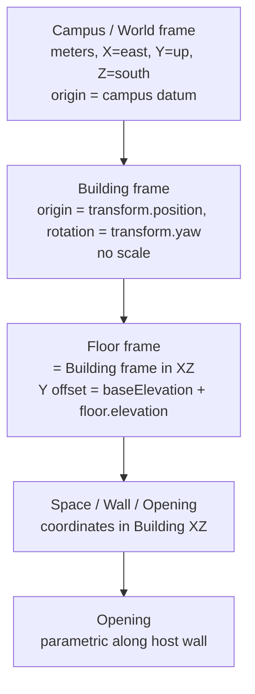
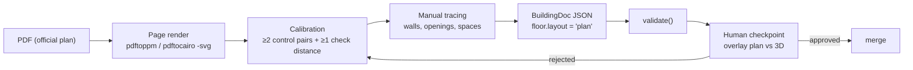

# GEOMETRY_SPEC — единая спецификация геометрии

> Статус документа: **черновик архитектора, v0.1 (2026-10-14)**.
> Всё в разделе §1 — **факт**, подтверждённый кодом ветки `feature/detailed-c-block` (коммит `01c4265`).
> Разделы §2–§9 — **предложение** (статус `proposed` в [DECISIONS.md](DECISIONS.md)), пока не утверждены человеком.
> Открытые вопросы — §10 и [IMPLEMENTATION_PLAN.md](IMPLEMENTATION_PLAN.md#открытые-вопросы-блокирующие-этапы).

Этот документ — единственное место, где определяются единицы, системы координат, форматы геометрических данных, ID и правила импорта/валидации. Остальные документы ссылаются сюда и не дублируют эти правила.

---

## 1. Текущее состояние (подтверждено кодом)

### 1.1 Единицы и оси

Источник: [`src/domain/geometry/types.ts`](../src/domain/geometry/types.ts).

| Свойство | Значение |
|---|---|
| Единицы | метры |
| Оси | `X` = восток, `Y` = вверх, `Z` = юг (север = `-Z`) |
| 2D-точка | `Vec2 = [x, z]` (вторая компонента — это **Z**, а не Y) |
| 3D-точка | `Vec3 = [x, y, z]` |
| Точность | `GeometryPrecision = 'approximate' \| 'surveyed'`; сейчас везде `'approximate'` |

### 1.2 Начало координат кампуса

Мировое начало координат **неявно** определено центром изображения `public/reference/campus.jpg`:

```ts
// src/services/geometry/screenshotGeometryProvider.ts (pxRectToRect)
center = [((l + r) / 2 - imgW / 2) * mpp, ((t + b) / 2 - imgH / 2) * mpp]
size   = [(r - l) * mpp, (b - t) * mpp]
```

где `imageSizePx = [703, 1024]` и `metersPerPixel = 0.3` из [`src/config/mapConfig.ts`](../src/config/mapConfig.ts). Масштаб `0.3 м/px` помечен в коде как **оценка** (`TODO: Calibrate`). Верх изображения = север.

> [!WARNING]
> **Конфликт данных.** В коммите `01c4265` прямоугольники в [`src/data/reference-footprints.ts`](../src/data/reference-footprints.ts) заменены на раскладку «нового официального мастер-плана». Их координаты выходят за пределы изображения (x до 750, y до 1050 при размере 703×1024) и не совпадают со спутниковым снимком, который по-прежнему показывает `ReferenceOverlay`. В ветке `main` прямоугольники обведены по снимку. Какая раскладка авторитетна, неизвестно (вопрос Q2). Сам мастер-план в репозитории отсутствует.

### 1.3 Здания

- Источник формы: `buildingFootprintsPx: Record<buildingId, PxRect[]>`, где `PxRect = [left, top, right, bottom]` — пиксели изображения, **только прямоугольники без поворота**.
- Провайдер переводит каждый прямоугольник в `Footprint { type: 'rect', center, size }` в **мировых** координатах. Локальной системы координат здания нет.
- `BuildingGeometry.height = max(level) * floorHeight` (`floorHeight = 3.6`).
- `BuildingGeometry.center` — центр bbox всех частей на уровне земли; `radius` — половина диагонали bbox (используется для камеры).
- Здание без footprint в данных → `console.warn`, в 3D не рисуется, но остаётся в UI-списке.

### 1.4 Этажи

- `FloorGeometry.elevation = (level - 1) * floorHeight` — **вычисляется**, не хранится. Высота всех этажей одинакова (3.6 м). Подвалы (`level <= 0`) типом допускаются, но данными и провайдером не проверялись.
- Плита перекрытия: `slabThickness = 0.25`, рисуется по **полному контуру здания** (`Floor.tsx` → `ExtrudedFootprint` по `geometry.parts`).

### 1.5 Помещения

- Геометрию даёт **процедурная раскладка** [`layoutRoomsInRect`](../src/services/geometry/proceduralRoomLayout.ts): только внутри **самого большого** прямоугольника здания, коридор + 1–2 ряда коробок.
- Тип результата — `RoomGeometry { type: 'box', position (центр), size, precision: 'approximate' }`; `y = elevation + slabThickness + roomHeight / 2`, `roomHeight = 2.6`.
- Вариант `RoomGeometry { type: 'polygon', points, elevation, height }` **поддерживается рендером** (`PolygonRoomMesh` в [`Room.tsx`](../src/components/3d/Room.tsx)), но ни одни данные его не используют.
- В `ScreenshotGeometryOptions.roomOverrides` можно передать точную геометрию по `roomId`, но [`services/geometry/index.ts`](../src/services/geometry/index.ts) эту опцию не передаёт.
- Стен, дверей, окон, лестниц, лифтов и коридоров как сущностей данных **нет**. «Коридор» существует только как зазор в процедурной раскладке.

### 1.6 Идентификаторы (фактический формат)

| Сущность | Формат | Где формируется | Стабильность |
|---|---|---|---|
| Кампус | `ajou-tashkent` | `campus-structure.ts` | стабилен |
| Здание | `bld-a` … `bld-j` | `campus-structure.ts` | стабилен (литералы) |
| Этаж | `${buildingId}-f${level}` | `demo-campus.ts` `buildFloor` | стабилен при неизменном `level` |
| Помещение | `${buildingId}-f${level}-r${i+1}` | `demo-campus.ts` `buildRoomsForFloor` | **нестабилен**: зависит от порядка в массиве |
| Особые помещения | `room-c-sport`, `room-c-conf`, `room-canteen` | `demo-campus.ts` `specialRooms` | стабильны (литералы) |

Связь с метаданными: геометрия хранится в `Record<id, …>` и связана с бизнес-данными только по строковому ID. Расписание (`Lesson.roomId`) тоже ссылается на `Room.id`.

Другие наблюдения:
- `shortName` не уникален: `'C'` у трёх зданий (`bld-e`, `bld-f`, `bld-i`).
- Номера комнат из расписания (`A-102` и т.п.) раскладываются по этажам эвристикой по подстроке (`-${level}0` / `-${level}1`).
- Семантика ID зданий противоречива: например, `bld-a` в `campus-structure.ts` называется «North Building», а в комментариях `reference-footprints.ts` и `DetailedBuilding.tsx` — «Учебный корпус №1» (вопрос Q3).

### 1.7 Поворот — расхождение конвенций

- `footprintOutline()` в [`geometryUtils.ts`](../src/components/3d/geometryUtils.ts) поворачивает так: `x' = x·cos − z·sin`, `z' = x·sin + z·cos`.
- `Room.tsx` передаёт `rotation` в `three.js` как `rotation.y`. Это даёт **противоположное** направление: `x' = x·cos + z·sin`, `z' = −x·sin + z·cos`.
- Сейчас ни одни данные не задают `rotation`, поэтому видимых ошибок нет. Конвенция выбирается в §3.3.

### 1.8 Построение 3D-мешей

- Контур `Vec2[]` → `THREE.Shape` с точками `(x, −z)` → `ExtrudeGeometry(depth = height)` → поворот меша `[-π/2, 0, 0]`, позиция `[0, bottom, 0]` ([`geometryUtils.ts`](../src/components/3d/geometryUtils.ts)). Результат лежит в мировых `(x, z)`, выдавливание идёт вверх по `+Y`.
- [`DetailedBuilding.tsx`](../src/components/3d/DetailedBuilding.tsx) строит окна, цоколь, крыши и карнизы по **bbox** каждой части. Для непрямоугольных или повёрнутых частей это даст искажённые детали.

---

## 2. Принципы целевой модели (proposed)

1. **Render-контракт остаётся.** `CampusGeometry` и `CampusGeometryProvider` из `src/domain/geometry/types.ts` остаются границей рендера (ADR-003). Новые данные приходят в рендер через новый провайдер.
2. **Отдельная authoring-модель.** Геометрия хранится в версионированном документе `CampusDocument` с **локальными** системами координат зданий (ADR-005). Рендер получает мировые координаты, вычисленные из документа.
3. **Документ — единый источник правды** и для бизнес-метаданных помещений, и для их геометрии. TS-типы домена (`Campus`, `Room`) по-прежнему не знают о геометрии: `Campus` выводится из документа загрузчиком.
4. **Оболочка отделена от интерьера.** Внешний контур здания (shell) и внутренняя планировка (walls/spaces/openings) — независимые наборы данных в одной локальной системе здания (ADR-009, §6).
5. **Реальные размеры не масштабируются неявно** (§6).
6. **Никаких выдуманных данных.** Всё, чего нет в источнике, помечается `provenance: 'demo'` или `needsReview`.

---

## 3. Системы координат (proposed)

### 3.1 Иерархия



| Система | Где применяется | Начало | Ориентация |
|---|---|---|---|
| **Campus (world)** | положение зданий, контекст (газоны, дороги), `CampusGeometry` | campus datum (§3.2) | X восток, Z юг, Y вверх |
| **Building** | shell, стены, пространства, вертикальные связи | `transform.position` в campus | `transform.yaw` относительно campus |
| **Floor** | те же XZ, что у здания; добавляется только высота | — | — |
| **Space / Room** | отдельной системы **нет**: полигоны хранятся в координатах здания | — | — |
| **Opening** | параметрически на стене: `offset` вдоль осевой линии | `wall.start` | направление `start → end` |

Обоснование: у системы помещения нет практической пользы, а преобразование лишний раз усложняет редактор. Этажи одного здания делят одну XZ-систему, поэтому стены и лестницы совпадают по вертикали без пересчёта.

### 3.2 Campus datum

- Мировое начало **замораживается численно**, равным текущему: центр изображения `campus.jpg` (703×1024 px) при `0.3 м/px`. Мировые координаты существующих зданий при миграции v0→v1 не меняются.
- Datum хранится в документе как описание и легаси-параметры (`legacyReference`). Пиксели перестают быть рабочими координатами.
- Если позже появятся геодезические координаты, привязка (WGS84/UTM → campus) добавится отдельным полем `geoReference` без сдвига campus-координат.

### 3.3 Конвенция поворота `yaw`

- `yaw` — радианы, вращение вокруг `+Y`, **как `Object3D.rotation.y` в three.js**. На карте с севером вверху положительный `yaw` вращает **против часовой стрелки**: восток → север.
- Формула local → world для точки здания `(x, z)`:

```text
x_w = px + x·cos(yaw) + z·sin(yaw)
z_w = pz − x·sin(yaw) + z·cos(yaw)
```

- Обратное преобразование: вычесть `(px, pz)` и повернуть на `−yaw`.
- `footprintOutline()` нужно привести к этой конвенции, когда появятся первые данные с поворотом (задача A2). До этого изменение не влияет на картинку.
- Рендер нормализует `yaw` в `(−π, π]`; в документе допускается любое значение.

### 3.4 Высоты

```text
Y_world(floor slab top) = building.baseElevation + floor.elevation
Y_world(space floor)    = Y_world(floor slab top)          // отделка пола не моделируется
space clear height      = space.clearHeight ?? (floor.height − floor.slabThickness)
```

- `baseElevation` по умолчанию `0` (ровный кампус). Рельеф не моделируется.
- `floor.elevation` в v1 **хранится явно**. Миграция записывает `(level − 1) · 3.6`, чтобы не ломать текущее поведение. Реальные отметки из PDF (разрезы) имеют приоритет.
- `floor.height` — высота этажа «от пола до пола». У последнего этажа это высота до низа кровли.

### 3.5 Ориентация полигонов

- Полигон — массив вершин **без** повторения первой точки в конце.
- Обход: **против часовой стрелки на карте с севером вверху**, т.е. знаковая площадь, вычисленная по точкам `(x, −z)`, положительна. Валидатор нормализует порядок и предупреждает об исправлении.
- Отверстия (дворики) в v1 не поддерживаются: U-образные здания задаются одним невыпуклым полигоном или несколькими частями (как сейчас).

---

## 4. Формат данных `CampusDocument` v1 (proposed)

### 4.1 Расположение файлов

```text
src/data/campus-document/
  campus.json            # schemaVersion, datum, список зданий (порядок), context, sources, calibrations
  buildings/
    bld-a.json           # одно здание = один файл (меньше конфликтов между агентами)
    …
```

Загрузка — статическим импортом JSON через Vite (`resolveJsonModule: true` уже включён в `tsconfig.json`). Отдельный бэкенд не нужен (ADR-013).

### 4.2 Схема (TypeScript-нотация; будущий файл `src/domain/document/types.ts`)

```ts
type Meters = number;          // хранится с точностью до 0.001 (мм)
type Radians = number;
type Vec2 = [x: Meters, z: Meters];   // тот же тип, что в domain/geometry

type CampusDocument = {
  schemaVersion: 1;
  campusId: string;                    // 'ajou-tashkent'
  name: string;
  units: 'm';
  datum: {
    description: string;               // текст из §3.2
    legacyReference?: { imageUrl: string; imageSizePx: [number, number]; metersPerPixel: number };
    geoReference?: unknown;            // зарезервировано, не используется в v1
  };
  buildingIds: string[];               // порядок = порядок в UI
  context: ContextFeatureDoc[];        // world frame
  sources: SourceDoc[];
  calibrations: CalibrationDoc[];
};

type BuildingDoc = {
  schemaVersion: 1;
  id: string;                          // 'bld-h' — неизменяем
  name: string;
  shortName: string;
  description?: string;
  provenance: 'confirmed' | 'demo';
  transform: { position: Vec2; yaw: Radians };   // campus frame, БЕЗ масштаба
  baseElevation: Meters;               // default 0
  shell: {
    parts: LocalFootprint[];           // building frame
    precision: GeometryPrecisionDoc;
    sourceRefs?: SourceRef[];
  };
  floors: FloorDoc[];
  verticals: VerticalDoc[];            // лестницы/лифты/пандусы, связывают этажи
  locks?: { shell?: boolean; interior?: boolean };   // см. §6
  appearance?: Record<string, unknown>;              // этап C; схема — позже, отдельным ADR
};

type LocalFootprint =
  | { type: 'rect'; center: Vec2; size: Vec2; rotation?: Radians }  // rotation — §3.3
  | { type: 'polygon'; points: Vec2[] };

type FloorDoc = {
  id: string;                          // `${buildingId}-f${level}` — неизменяем
  level: number;                       // 1 = первый (наземный); 0/отрицательные = подвал
  name: string;
  elevation: Meters;                   // относительно baseElevation
  height: Meters;                      // от пола до пола
  slabThickness: Meters;
  outline?: Vec2[];                    // контур плиты, если отличается от shell (building frame)
  layout: 'procedural' | 'plan';       // 'procedural' = как сейчас; 'plan' = данные из PDF
  walls: WallDoc[];
  openings: OpeningDoc[];
  spaces: SpaceDoc[];
  sourceRefs?: SourceRef[];
};

type WallDoc = {
  id: string;
  start: Vec2; end: Vec2;              // ОСЕВАЯ линия, building frame
  thickness: Meters;                   // полная толщина, симметрично от оси
  kind: 'exterior' | 'interior' | 'partition' | 'curtain';
  height?: Meters;                     // default = floor.height − floor.slabThickness
  precision: GeometryPrecisionDoc;
  sourceRefs?: SourceRef[];
};

type OpeningDoc = {
  id: string;
  wallId: string;
  kind: 'door' | 'double-door' | 'window' | 'opening';
  offset: Meters;                      // от wall.start до ЦЕНТРА проёма вдоль оси
  width: Meters;
  height: Meters;
  sill?: Meters;                       // для окон; у дверей 0
  swing?: { side: 'left' | 'right'; direction: 'in' | 'out' };  // необязательно; не угадывать
  connects?: [spaceIdA: string | null, spaceIdB: string | null];  // null = снаружи
  needsReview?: string;
};

type SpaceKind =
  | 'room' | 'corridor' | 'hall' | 'lobby' | 'stair' | 'elevator'
  | 'wc' | 'technical' | 'storage' | 'shaft' | 'other';

type SpaceDoc = {
  id: string;                          // для помещений с room — это и есть Room.id домена
  kind: SpaceKind;
  polygon: Vec2[] | null;              // ЧИСТЫЙ контур (по внутренней грани стен); null = геометрии нет
  clearHeight?: Meters;
  precision: GeometryPrecisionDoc;
  room?: {                             // присутствует → порождает доменный Room
    number: string;                    // как в официальном источнике, без нормализации
    name?: string;
    roomKind: RoomKind;                // существующий union из domain/campus/types.ts
    capacity?: number;
    provenance: 'confirmed' | 'demo';
  };
  legacyIds?: string[];                // прежние ID (§5.3)
  sourceRefs?: SourceRef[];
  needsReview?: string;
};

type VerticalDoc = {
  id: string;
  kind: 'stair' | 'elevator' | 'ramp' | 'escalator';
  floorIds: string[];                  // упорядочены снизу вверх, только этого здания
  spaceIds: string[];                  // соответствующие SpaceDoc kind 'stair'|'elevator' на каждом этаже
};

type GeometryPrecisionDoc = 'approximate' | 'plan' | 'surveyed';
// approximate = обведено по спутнику / процедурно; plan = из официального чертежа; surveyed = обмер.

type SourceDoc = {
  id: string;                          // 'src-bld-h-f1-pdf'
  kind: 'pdf' | 'satellite' | 'masterplan' | 'manual';
  file: string;                        // путь в репозитории или описание; без персональных данных
  page?: number;
  note?: string;
};
type SourceRef = { sourceId: string; page?: number };

type CalibrationDoc = {
  id: string;
  sourceId: string;
  page: number;
  /** Аффинное ПОДОБИЕ (сдвиг + поворот + равномерный масштаб) из координат листа в building frame. */
  similarity: { scale: number; rotation: Radians; translate: Vec2 };
  controlPairs: { sheet: [number, number]; building: Vec2; note?: string }[];   // ≥ 2
  checkDistances: { a: Vec2; b: Vec2; expected: Meters; measured: Meters }[];  // ≥ 1, не участвуют в подгонке
  maxRelativeError: number;            // по checkDistances
  approvedBy?: string;                 // роль/инициалы проверяющего, без персональных данных
};

type ContextFeatureDoc = ContextFeature;  // существующий тип, world frame, без изменений
```

### 4.3 Соответствие render-модели (что выдаёт `DocumentGeometryProvider`)

| Документ | `CampusGeometry` |
|---|---|
| `BuildingDoc.shell.parts` + `transform` | `BuildingGeometry.parts` как `{type:'polygon'}` в world (прямоугольники с `yaw ≠ 0` превращаются в полигоны) |
| `FloorDoc.elevation + baseElevation`, `height` | `FloorGeometry.elevation`, `height` |
| `SpaceDoc.polygon` (есть `room`) | `RoomGeometry { type:'polygon', points(world), elevation, height, precision }` |
| `FloorDoc.layout === 'procedural'` | fallback: `layoutRoomsInRect` с теми же параметрами, что сейчас → `type:'box'` |
| `walls`, `openings`, `verticals`, пространства без `room` | **новые** поля render-модели (`floorPlans`) — добавляются в `CampusGeometry` в задаче A7 с обновлением этого документа |
| `connectors` (межкорпусные переходы) | `CampusGeometry.connectors: ConnectorGeometry[]` (ADR-020) — замкнутые наземные объемы переходов между корпусами |
| `precision: 'plan'` | требуется расширить `GeometryPrecision` (сейчас `'approximate' \| 'surveyed'`). Затрагивает `RoomDetails.tsx` (`!== 'surveyed'`) — ADR-007 |


### 4.4 Правила построения геометрии

1. Все вычисления local→world выполняются **только** в провайдере/утилите `src/domain/geometry/transform.ts` (задача A2). React-компоненты получают готовые world-координаты (это продолжает правило README: «не хардкодить координаты в UI»).
2. **Стена** → призма: прямоугольник `length × thickness`, повёрнутый по оси `start→end`, высота `wall.height`. Проёмы вычитаются разбиением стены на сегменты вдоль оси: сегменты под и над проёмом (без CSG).
3. **Пространство** → полигон пола (цвет — по статусу расписания для `room`, по `kind` для остальных) + опциональная призма высотой `clearHeight` (как сейчас `PolygonRoomMesh`).
4. **Плита** → `floor.outline ?? shell.parts`, толщина `slabThickness`.
5. **Вертикали** → маркеры на каждом этаже из `floorIds`; пространства лестниц рендерятся как обычные spaces.
6. Детерминизм: одинаковый документ → бит-в-бит одинаковый `CampusGeometry`. Никакого `Math.random` в провайдере.

---

## 5. Идентификаторы и метаданные (proposed)

### 5.1 Общие правила

- ID — строки `[a-z0-9-]` (для `room.number` ограничений нет). Уникальны в своей области: здания — в кампусе; этажи, стены, проёмы, пространства — глобально (проще валидировать ссылки).
- **ID не переиспользуются и не пересчитываются.** Удалённый ID не выдаётся снова.
- ID не кодируют геометрию и не зависят от порядка в массиве.

### 5.2 Форматы новых ID

| Сущность | Формат | Пример |
|---|---|---|
| Здание | существующие `bld-a` … `bld-j`; новые — `bld-<slug>` | `bld-h` |
| Этаж | `${buildingId}-f${level}`; подвал `${buildingId}-b${n}` | `bld-h-f1` |
| Пространство с номером | `${floorId}-${slug(number)}` при **создании**; не меняется при переименовании | `bld-h-f1-a-102` |
| Пространство без номера | `${floorId}-${kind}-${n}`, где `n` — следующий свободный | `bld-h-f1-corridor-1` |
| Стена / проём | `${floorId}-w${n}` / `${floorId}-d${n}` | `bld-h-f1-w12` |
| Вертикаль | `${buildingId}-${kind}-${n}` | `bld-h-stair-1` |

`slug` = нижний регистр, всё кроме `[a-z0-9]` заменяется на `-`, повторы схлопываются.

### 5.3 Совместимость со старыми ID

- Миграция v0→v1 **сохраняет** текущие ID помещений (`bld-h-f1-r1`, `room-c-conf`, …) как есть. Начиная с этого момента они стабильны, потому что больше не генерируются по индексу.
- Если при импорте PDF пространство получает новый ID, старый записывается в `legacyIds`, а загрузчик строит таблицу алиасов `legacyId → id` для расписания и сохранённых ссылок.
- Демо-помещение (`provenance: 'demo'`), которого нет на плане, **удаляется** (это не потеря данных), а его ID попадает в отчёт импорта.

### 5.4 Метаданные

- Номер помещения (`room.number`) записывается **точно как в источнике**. Расхождение номера в PDF и в расписании не исправляется молча: пространство получает `needsReview` с описанием расхождения.
- `RoomKind` (`classroom | lab | office | hall | other`) не меняется в рамках этапа A. Коридоры, лестницы и санузлы — это `SpaceDoc.kind` без `room`; они не попадают в поиск и расписание.

---

## 6. Изменение пропорций здания без искажения интерьера (proposed)

Корень проблемы: сейчас процедурные комнаты выводятся из footprint, поэтому любое изменение footprint их пересчитывает. Для данных из PDF так нельзя.

### 6.1 Правила

| # | Операция | Разрешено для | Что меняется | Что НЕ меняется |
|---|---|---|---|---|
| R1 | Перемещение / поворот здания (`transform`) | всех | всё здание жёстко | любые локальные размеры |
| R2 | Редактирование вершин shell | всех, если `locks.shell != true` | только `shell.parts` | стены, проёмы, пространства |
| R3 | Масштаб shell (`resize`) | только зданий, у которых **все** этажи `layout: 'procedural'` | `shell.parts`; процедурные комнаты пересчитываются автоматически | — |
| R4 | Перекалибровка плана этажа | этажей `layout: 'plan'`, только явным действием с указанием причины | все координаты интерьера этажа — **равномерным** подобием, с записью новой `CalibrationDoc` | wall.thickness масштабируется вместе с планом; неравномерный масштаб запрещён |
| R5 | Редактирование отдельных стен / проёмов / пространств | этажей с `locks.interior != true` | только выбранный объект и, при перемещении, привязанные проёмы | соседние объекты не тянутся автоматически |

### 6.2 Инварианты

1. **В `BuildingDoc.transform` нет масштаба.** Масштабный коэффициент существует только в `CalibrationDoc`.
2. **Неравномерного масштабирования интерьера нет** ни в одной операции.
3. После правки shell валидатор проверяет, что пространства и наружные стены лежат внутри shell (допуск 0.05 м). Нарушение — **ошибка** для `precision: 'plan' | 'surveyed'` и предупреждение для `approximate`.
4. Если наружная грань наружных стен плана отличается от shell более чем на 0.5 м, это **предупреждение**. Решение принимает человек: подвинуть shell (R2) или здание целиком (R1). План ради совпадения со спутником не меняется.
5. После импорта плана здание по умолчанию получает `locks.interior = true`. Снимается блокировка явно.

---

## 7. Валидация (proposed; будущий `src/domain/document/validate.ts`)

Уровни: **error** блокирует сохранение и сборку данных, **warning** попадает в отчёт.

| Код | Уровень | Правило |
|---|---|---|
| V-ID-1 | error | ID уникальны, соответствуют §5, ссылки (`wallId`, `floorIds`, `spaceIds`, `sourceId`, `connects`) разрешаются |
| V-POLY-1 | error | ≥ 3 вершины, нет совпадающих соседних (< 0.001 м), нет самопересечений, площадь > 0.25 м² |
| V-POLY-2 | warning | обход не по §3.5 (автоисправляется) |
| V-WALL-1 | error | длина > 0.05 м; `0.05 ≤ thickness ≤ 1.5` |
| V-OPEN-1 | error | `width/2 ≤ offset ≤ length − width/2`; проёмы одной стены не перекрываются |
| V-OPEN-2 | warning | `door.width` вне диапазона 0.6–3.0 м; `height` вне 1.8–3.5 м (вероятная ошибка масштаба) |
| V-SPACE-1 | error (plan) / warning | пространство внутри `floor.outline ?? shell` (допуск 0.05 м) |
| V-SPACE-2 | warning | пересечение пространств одного этажа > 0.1 м² |
| V-FLOOR-1 | error | `level` уникален в здании; `elevation` строго растёт вместе с `level`; `height > slabThickness > 0` |
| V-VERT-1 | error | `floorIds` одного здания, идут по возрастанию уровня; на каждом этаже есть соответствующее пространство |
| V-ROOM-1 | error | `room.number` уникален в здании |
| V-ROOM-2 | warning | доменный Room без геометрии (`polygon: null`) на этаже `layout: 'plan'` |
| V-CAL-1 | error | у этажа `plan` есть калибровка с `maxRelativeError ≤ 0.01` и ≥ 1 контрольным расстоянием |
| V-NUM-1 | error | все числа конечны; на сохранении округляются до 0.001 м и 1e-6 рад |

---

## 8. Импорт из PDF (proposed)

### 8.1 Конвейер



- Инструменты на машине разработчика (проверено): `pdfinfo`, `pdftotext`, `pdftoppm` (poppler), `python3`. `mutool` не установлен. Векторный это PDF или скан — неизвестно (Q1), от этого зависит, можно ли извлекать линии из SVG полуавтоматически.
- **Автоматическое распознавание** (CV/ML) в этапе A **не используется**. Трассировка ручная или полуавтоматическая из векторного SVG с обязательной проверкой.
- До появления 2D-редактора (этап B) трассировку выполняет инструмент из задачи A5 (см. [IMPLEMENTATION_PLAN.md](IMPLEMENTATION_PLAN.md)).

### 8.2 Правила обработки неоднозначностей

| Ситуация | Действие |
|---|---|
| Нет масштабной линейки / размеров | этаж не импортируется; вопрос к человеку |
| Контрольные расстояния расходятся > 1% | калибровка отклоняется (V-CAL-1) |
| Номер помещения нечитаем | `room` не создаётся; `needsReview: 'number unreadable'` |
| Номер в PDF ≠ номер в расписании | сохраняется номер из PDF + `needsReview`; расписание не правится |
| Направление открывания двери неясно | `swing` не задаётся |
| План этажа не совпадает с shell | правило §6.2 п.4, план не искажается |
| Помещение есть в расписании, нет на плане | Room остаётся с `polygon: null` + V-ROOM-2 + запись в отчёт |
| Разные PDF противоречат друг другу | приоритет у более позднего по дате; конфликт — в отчёт и человеку |

### 8.3 Отчёт импорта

Каждый импорт этажа сопровождается `docs/import-reports/<floorId>.md`: источник (файл, страница), калибровка и ошибки, количество стен, проёмов и пространств, список `needsReview`, удалённые демо-ID, `legacyIds`, скриншоты наложения. Отчёт — артефакт для человеческой проверки.

---

## 9. Версионирование и миграция (proposed)

- Поле `schemaVersion` есть в `campus.json` и в каждом `buildings/*.json`. Загрузчик принимает только известные версии; неизвестная версия вызывает явную ошибку, а не попытку угадать формат.
- Миграции — чистые функции `migrateVnToVn1(doc) → doc` в `src/domain/document/migrations/` с тестами «старый фикстур → новый фикстур».
- Изменение формата — это **изменение контракта**: новый ADR, обновление §4 и миграция в одном изменении.

### 9.1 Миграция v0 → v1 (текущий TS → документ)

v0 = `campus-structure.ts` + `demo-campus.ts` + `reference-footprints.ts` + `mapConfig` + процедурная раскладка.

1. Для каждого здания: прямоугольники → world (существующая формула §1.2) → `transform.position` = центр bbox, `yaw = 0` → `shell.parts` = те же прямоугольники в локальных координатах (`center − position`), `precision: 'approximate'`.
2. Этажи: `elevation = (level − 1) · 3.6`, `height = 3.6`, `slabThickness = 0.25`, `layout: 'procedural'`, пустые `walls/openings`.
3. Помещения: каждый текущий `Room` → `SpaceDoc { id: <текущий id>, kind: 'room', polygon: null, room: {…}, precision: 'approximate' }`. Процедурный fallback строит те же коробки.
4. `contextFeaturesPx` → `context` в world (как сейчас).
5. **Критерий корректности:** `DocumentGeometryProvider.build()` по документу v1 даёт `CampusGeometry`, совпадающий с `createScreenshotGeometryProvider(...).build()` с точностью 1e-6 по всем числам. Части `rect` при `yaw = 0` остаются `rect`. Это автоматический тест (задача A4).

---

## 10. Открытые вопросы, влияющие на эту спецификацию

Полный список с влиянием — в [IMPLEMENTATION_PLAN.md](IMPLEMENTATION_PLAN.md#открытые-вопросы-блокирующие-этапы). Здесь только касающиеся геометрии:

- **Q1** Где лежат PDF, векторные ли они, есть ли масштаб и размеры? → §8.
- **Q2** Какая раскладка зданий авторитетна: `main` (спутник) или `01c4265` («мастер-план»)? → §1.2, §9.1 (из какой раскладки мигрировать).
- **Q3** Соответствие `bld-*` ↔ реальные корпуса. → §5, наименования.
- **Q4** Есть ли хотя бы одно реальное измерение для калибровки `metersPerPixel`? → §3.2.
- **Q5** Реальные высоты этажей по корпусам. → §3.4.
- **Q9** Есть ли подвалы, антресоли, разноуровневые этажи? → §3.4, `FloorDoc`.
