# IMPLEMENTATION_PLAN — детальный план реализации

> Статус документа: **черновик архитектора v0.1 (2026-10-14)**.
> План строго следует утверждённой последовательности: **Этап A → Этап B → Этап C** ([ADR-004](DECISIONS.md#adr-004-фиксированная-последовательность-этапов-a--b--c)).
> Спецификации геометрии и схемы данных зафиксированы в [GEOMETRY_SPEC.md](GEOMETRY_SPEC.md). Архитектурный контекст описан в [ARCHITECTURE.md](ARCHITECTURE.md).

---

## Общая дорожная карта

```mermaid
flowchart TD
  subgraph StageA["Этап A: Точные планировки"]
    A0["A0: Подготовка тестовой базы и .gitignore"]
    A1["A1: Аудит доступных PDF и контрольная калибровка"]
    A2["A2: Модуль трансформаций и конвенция yaw"]
    A3["A3: Схема типов CampusDocument и валидатор"]
    A4["A4: Миграция v0 → v1 (демо-данные в JSON)"]
    A5["A5: Инструментарий калибровки и трассировки"]
    A6["A6: ПИЛОТ: Импорт 1 этажа + Human Checkpoint #1"]
    A7["A7: Аддитивное расширение 3D-рендера (стены/проёмы)"]
    A8["A8: Массовый импорт остальных этажей + Checkpoint #2"]
  end

  subgraph StageB["Этап B: 2D Edit Mode"]
    B1["B1: Хранилище DocumentStore и Command Pattern"]
    B2["B2: Векторный 2D-вьюпорт (SVG) и навигация"]
    B3["B3: Редактирование корпусов и сетка привязок"]
    B4["B4: Инструменты редактирования стен и проёмов"]
    B5["B5: Редактирование помещений и метаданных"]
    B6["B6: Валидация в реальном времени и инспекторы свойств"]
    B7["B7: Синхронизация 2D ↔ 3D и экспорт документа"]
    B8["B8: Human Checkpoint #3 и приёмка редактора"]
  end

  subgraph StageC["Этап C: Визуальное улучшение"]
    C1["C1: Локализация ассетов (отказ от внешних CDN)"]
    C2["C2: Конфигурация стилей фасадов (appearance)"]
    C3["C3: Освещение, тени и атмосфера"]
    C4["C4: Детерминированное благоустройство и растительность"]
    C5["C5: Оптимизация производительности (LOD/инстансинг)"]
    C6["C6: Финальная приёмка качества"]
  end

  A0 --> A1 --> A2 --> A3 --> A4 --> A5 --> A6 --> A7 --> A8
  A8 ==>|Gate A → B| B1
  B1 --> B2 --> B3 --> B4 --> B5 --> B6 --> B7 --> B8
  B8 ==>|Gate B → C| C1
  C1 --> C2 --> C3 --> C4 --> C5 --> C6
```

---

## Открытые вопросы, блокирующие этапы

| ID | Вопрос | Текущее наблюдение | Влияние на реализацию | Действие до старта задачи |
|---|---|---|---|---|
| **Q1** | Где расположены PDF-файлы планировок и каков их тип? | **[РЕШЕНО]** В корне репозитория добавлен `Campus map (3).pdf`. Проведён аудит, сформирован `docs/PDF_INVENTORY.md`. | Разблокировало A1: листы экспортированы в `tools/input-sheets/`. | Завершено. |
| **Q2** | Какая раскладка контуров зданий является официальной? | В коммите `01c4265` координаты заменены на схему «мастер-плана» (выходящую за рамки спутникового снимка `campus.jpg`). В `main` координаты обведены по снимку. | Блокирует A4/A6: определяет базовые мировые координаты `transform.position`. | Человек утверждает референсную раскладку (спутник vs мастер-план). |
| **Q3** | Точное соответствие идентификаторов `bld-a`…`bld-j` названиям блоков | **[РЕШЕНО]** На Слайде 1 `Campus map (3).pdf` и в `docs/PDF_INVENTORY.md §3` зафиксирована полная таблица соответствия (A→`bld-h`, B→`bld-g`, D→`bld-c`, E→`bld-b`, F→`bld-d`, C→`bld-e`/`f`/`i`). | Разблокировало импорт планировок. | Завершено. |
| **Q4** | Калибровочные размеры зданий для снимка кампуса | В коде `metersPerPixel = 0.3` помечен как грубая оценка по футбольному полю. | Влияет на абсолютную точность привязки зданий к кампусу. | Замерить на спутнике или в CAD хотя бы одну контрольную дистанцию (например, длину фасада Блока А). |
| **Q5** | Фактические высоты этажей по корпусам | В коде принята константа 3.6 м для всех этажей всех корпусов. | Влияет на отметки `elevation` в 3D. В чертежах АР/АС высоты могут быть 3.3 м, 3.9 м, 4.2 м. | Снять отметки высот из разрезов чертежей при выполнении A1. |
| **Q6** | Наличие подвалов, цокольных этажей и антресолей | Сейчас поддерживаются уровни `level: 1..N`. Подвалы (`level <= 0`) не проверены. | Влияет на структуру этажей в `FloorDoc` и `FloorSelector`. | Уточнить по составу листов чертежей в A1. |

---

## ЭТАП A: Точные планировки помещений

### Цель этапа
Перенести фактическую геометрию помещений (стены, коридоры, двери, лестничные клетки, кабинеты) из доступных PDF-чертежей в единый формат данных и обеспечить их корректное отображение в существующей 3D-сцене с сохранением всех идентификаторов и метаданных расписания.

### Входные зависимости
- Официальные PDF-файлы архитектурных планов (вопрос Q1).
- Утверждённая спецификация [GEOMETRY_SPEC.md](GEOMETRY_SPEC.md).

---

### Подробный перечень задач этапа A

#### Задача A0: Инфраструктурная стабилизация репозитория
- **Цель**: Обеспечить рабочую среду для тестирования и предотвратить засорение git-истории.
- **Действия**:
  1. Создать `.gitignore`, исключающий `node_modules/`, `dist/`, `.vite/`, временные логи и кэши.
  2. Удалить пустой файл-заглушку `scripts` в корневом каталоге.
  3. Создать директорию `tools/` для вспомогательных утилит ([ADR-019](DECISIONS.md#adr-019-размещение-инструментов-импорта-в-каталоге-tools-вместо-scripts)).
  4. Настроить базовый тест в `vitest` для проверки работоспособности `npm test`.
- **Затрагиваемые файлы**: `.gitignore`, `tools/`, `src/__tests__/smoke.test.ts`.
- **Критерии приёмки**: `npm test` завершается успешно (код 0); `git status` чист от кэшей.

#### Задача A1: Аудит предоставленных PDF и извлечение листов
- **Цель**: Идентифицировать все чертежи планировок, определить их масштаб и качество (вектор vs растр).
- **Действия**:
  1. Исследовать файлы PDF, предоставленные пользователем.
  2. Сформировать реестр листов: Корпус → Этаж → Файл/Лист → Масштаб / Экспликация.
  3. Сконвертировать нужные страницы в высокое разрешение (PNG/SVG) через `pdftoppm` / `pdftocairo` в каталог `tools/input-sheets/`.
- **Критерии приёмки**: Документ `docs/PDF_INVENTORY.md` с перечнем всех листов, отметками читаемости экспликаций и наличием размерных цепочек.

#### Задача A2: Модуль геометрических трансформаций и конвенция yaw
- **Цель**: Реализовать чистые математические функции преобразования координат согласно [GEOMETRY_SPEC.md §3](GEOMETRY_SPEC.md#3-системы-координат-proposed).
- **Действия**:
  1. Создать `src/domain/geometry/transform.ts`:
     - `localToWorld(point: Vec2, transform: Transform2D): Vec2`
     - `worldToLocal(point: Vec2, transform: Transform2D): Vec2`
     - Учесть конвенцию `yaw` (three.js `rotation.y`, против часовой стрелки при взгляде сверху).
  2. Написать unit-тесты для прямых и обратных преобразований, поворотов на 0, 90, 180, 270 градусов.
  3. Проверить согласованность с `footprintOutline` в `geometryUtils.ts`.
- **Затрагиваемые файлы**: `src/domain/geometry/transform.ts`, `src/domain/geometry/__tests__/transform.test.ts`.
- **Критерии приёмки**: 100% покрытие тестами; погрешность обратного преобразования `< 1e-9`.

#### Задача A3: Описание схемы данных `CampusDocument` и валидатор
- **Цель**: Реализовать TypeScript-типы авторской модели и модуль валидации геометрии.
- **Действия**:
  1. Создать `src/domain/document/types.ts` в точном соответствии с [GEOMETRY_SPEC.md §4.2](GEOMETRY_SPEC.md#42-схема-typescript-нотация-будущий-файл-srcdomaindocumenttypests).
  2. Создать `src/domain/document/validate.ts` с проверкой правил `V-ID-1`, `V-POLY-1`, `V-WALL-1`, `V-OPEN-1`, `V-SPACE-1`, `V-CAL-1` и др. ([GEOMETRY_SPEC.md §7](GEOMETRY_SPEC.md#7-валидация-proposed-будущий-srcdocumentvalidatets)).
  3. Написать тесты валидатора с позитивными и негативными сценариями.
- **Затрагиваемые файлы**: `src/domain/document/types.ts`, `src/domain/document/validate.ts`, `src/domain/document/__tests__/validate.test.ts`.
- **Критерии приёмки**: Валидатор возвращает структурированный список `{ errors: Issue[], warnings: Issue[] }`.

#### Задача A4: Миграция v0 → v1 (демо-данные в формат JSON)
- **Цель**: Перевести текущие данные репозитория в формат `CampusDocument` без изменения визуального поведения.
- **Действия**:
  1. Написать скрипт миграции `tools/migrate-v0-to-v1.ts` по алгоритму [GEOMETRY_SPEC.md §9.1](GEOMETRY_SPEC.md#91-миграция-v0--v1-текущий-ts--документ).
  2. Сгенерировать файлы `src/data/campus-document/campus.json` и `src/data/campus-document/buildings/bld-*.json`.
  3. Разработать `DocumentGeometryProvider`, преобразующий `CampusDocument` в `CampusGeometry`.
  4. Написать сравнительный тест: результирующий `CampusGeometry` от старого `ScreenshotGeometryProvider` и нового `DocumentGeometryProvider` должен численно совпадать (погрешность `< 1e-6`).
  5. Подключить `DocumentGeometryProvider` в `src/services/geometry/index.ts`.
- **Затрагиваемые файлы**: `src/data/campus-document/`, `src/services/geometry/documentGeometryProvider.ts`, `src/services/geometry/index.ts`, `src/services/campus/campusService.ts`.
- **Критерии приёмки**: Приложение работает штатно в браузере; в 3D отображаются прежние здания и процедурные комнаты; `npm run typecheck` и `npm test` зелёные.

#### Задача A5: Инструментарий калибровки и полуавтоматической трассировки
- **Цель**: Обеспечить надёжный процесс переноса чертежей без ошибок масштаба.
- **Действия**:
  1. Разработать утилиту калибровки листа `tools/calibrate-sheet.py` (или TS-утилиту):
     - Ввод пар точек (пиксели листа ↔ координаты здания).
     - Расчёт аффинного подобия (сдвиг, поворот, единый масштаб).
     - Проверка контрольных отрезков и расчёт `maxRelativeError`.
  2. Сформировать структуру хранения трассировок и отчётов в `docs/import-reports/`.
- **Затрагиваемые файлы**: `tools/calibrate-sheet.*`, `docs/import-reports/`.
- **Критерии приёмки**: Утилита калибровки вычисляет параметры подобия и формирует блок `CalibrationDoc` с ошибкой `< 0.01` (1%).

#### Задача A6: ПИЛОТНЫЙ ИМПОРТ одного этажа + Контрольная точка #1
- **Цель**: Провести сквозную миграцию одного этажа (рекомендуется 1-й этаж Блока A / Блока H) и валидировать весь процесс на реальных данных.
- **Действия**:
  1. Откалибровать чертёж выбранного этажа по характерным углам несущих стен.
  2. Оцифровать наружные и внутренние стены, проёмы дверей и пространства (кабинеты, коридоры, лестницы).
  3. Сопоставить номера помещений с экспликацией и расписанием (`demo-campus.ts`).
  4. Записать результат в `buildings/bld-*.json` с флагом `layout: 'plan'`.
  5. Сформировать отчёт `docs/import-reports/<buildingId>-f1.md`.
  6. **Контрольная точка человека (Human Checkpoint #1)**:
     - Человек проверяет отчёт, наложение чертежа и корректность отображения в 3D.
     - Проверяется: масштаб дверных проёмов (0.8–1.2 м), ширина коридоров, совпадение номеров комнат.
- **Затрагиваемые файлы**: `src/data/campus-document/buildings/bld-*.json`, `docs/import-reports/`.
- **Критерии приёмки**: Пилотный этаж одобрен человеком; валидатор не возвращает ошибок `error`.

#### Задача A7: Аддитивное расширение 3D-рендера для элементов плана
- **Цель**: Отобразить реальные стены, проёмы и специализированные пространства в 3D-сцене.
- **Действия**:
  1. Расширить `CampusGeometry`: добавить структуры для отображения стен и проёмов ([ADR-007](DECISIONS.md#adr-007-аддитивное-расширение-render-модели-для-планировок-этажей)).
  2. Доработать `Floor.tsx`: если у этажа есть `plan`, рендерить геометрию стен с вырезами проёмов и чистые полигоны комнат; если нет — сохранять fallback на процедурные коробки.
  3. Обновить `Room.tsx` для поддержки непрямоугольных комнат и коридоров.
  4. Добавить визуализацию дверей и лестничных клеток.
- **Затрагиваемые файлы**: `src/domain/geometry/types.ts`, `src/components/3d/Floor.tsx`, `src/components/3d/Room.tsx`, `src/components/3d/geometryUtils.ts`.
- **Критерии приёмки**: На пилотном этаже видны реальные стены и коридоры; остальные этажи продолжают работать процедурно.

#### Задача A8: Массовый перенос остальных этажей + Контрольная точка #2
- **Цель**: Оцифровать все остальные корпуса и этажи кампуса по утверждённой на пилоте методике.
- **Действия**:
  1. Поэтапный импорт: Блок A (остальные этажи), Блок B, Блок C (спортзал, конгресс-холл, столовая), Блоки D/E/F, Общежитие.
  2. Для каждого этажа: калибровка → оцифровка → валидация → генерация отчёта в `docs/import-reports/`.
  3. Разрешение коллизий с номерами помещений (заполнение `needsReview` при несовпадении с расписанием).
  4. **Контрольная точка человека (Human Checkpoint #2)**:
     - Проверка полноты кампуса: все доступные чертежи перенесены.
     - Отсутствие критических предупреждений в валидаторе.
- **Затрагиваемые файлы**: `src/data/campus-document/buildings/*.json`, `docs/import-reports/*.md`.
- **Критерии приёмки**: Все здания с доступными планами переведены на `layout: 'plan'`; расписание корректно подсвечивает аудитории; поиск находит все подтверждённые кабинеты.

---

### Условия перехода к Этапу B (Gate A → B)
1. Все доступные PDF-планировки оцифрованы и валидированы без ошибок уровня `error`.
2. Пилотный и финальный отчёты импорта одобрены человеком.
3. 3D-карта корректно отображает точные стены и комнаты для всех импортированных этажей.
4. Поиск по комнатам и расписание работают стабильно без поломки существующих идентификаторов.
5. Автоматические тесты (`npm test`) и проверка типов (`npm run typecheck`) проходят успешно.

---

## ЭТАП B: 2D Edit Mode (Режим редактирования карты)

### Цель этапа
Разработать полноценный режим редактирования карты сверху (вид в плане): добавление, перемещение, масштабирование и удаление объектов (корпуса, этажи, стены, двери, комнаты) с поддержкой отмены/повтора действий, привязки к сетке и мгновенной синхронизацией с 3D-сценой.

### Входные зависимости
- Успешно завершённый Этап A.
- Стабилизированный формат `CampusDocument` v1.
- Утверждённые архитектурные решения [ADR-010](DECISIONS.md#adr-010-запрет-неявного-масштабирования-внутренней-геометрии), [ADR-014](DECISIONS.md#adr-014-command-pattern-и-централизованный-documentstore-для-2d-редактора), [ADR-017](DECISIONS.md#adr-017-выбор-svg-в-react-как-основы-для-2d-edit-mode).

---

### Подробный перечень задач этапа B

#### Задача B1: Централизованный DocumentStore и Command Pattern
- **Цель**: Создать архитектурную основу для редактирования данных с поддержкой Undo/Redo и транзакционности.
- **Действия**:
  1. Реализовать `src/editor/state/DocumentStore.ts`:
     - Текущее состояние `CampusDocument`.
     - Счётчик ревизий `revision: number`.
     - Стек истории команд (`undoStack`, `redoStack`, лимит глубины 50).
  2. Реализовать интерфейс `Command`:
     - `execute(doc: CampusDocument): CampusDocument`
     - `undo(doc: CampusDocument): CampusDocument`
  3. Реализовать базовые команды: `UpdateBuildingTransformCommand`, `AddWallCommand`, `MoveWallCommand`, `DeleteWallCommand`, `AddSpaceCommand` и др.
- **Затрагиваемые файлы**: `src/editor/state/DocumentStore.ts`, `src/editor/commands/*.ts`, тесты команд.
- **Критерии приёмки**: Unit-тесты подтверждают корректность `execute`, `undo`, `redo` для цепочек из 10+ действий.

#### Задача B2: Интерактивный векторный 2D-вьюпорт (SVG)
- **Цель**: Создать компонент плоского отображения карты сверху с плавным панорамированием и зумом.
- **Действия**:
  1. Создать `src/editor/components/Viewport2D.tsx` на базе SVG ([ADR-017](DECISIONS.md#adr-017-выбор-svg-в-react-как-основы-для-2d-edit-mode)).
  2. Реализовать матрицу трансформации вьюпорта (pan & zoom): поддержка колеса мыши, зажатия средней кнопки/пробела, тач-жестов.
  3. Реализовать переключение уровней детализации: «Весь кампус» (вид на все здания) ↔ «Этаж выбранного здания».
  4. Реализовать отображение координатной сетки (шаг 1 м, 5 м, 10 м) и масштабной линейки.
- **Затрагиваемые файлы**: `src/editor/components/Viewport2D.tsx`, `src/editor/hooks/useViewportTransform.ts`.
- **Критерии приёмки**: Плавный рендеринг 60 FPS; корректный перевод экранных пикселей мыши в координаты кампуса/здания.

#### Задача B3: Редактирование корпусов и привязка к сетке (Snapping)
- **Цель**: Обеспечить инструменты настройки положения, ориентации и внешнего контура зданий.
- **Действия**:
  1. Реализовать подсистему привязок `src/editor/utils/snapping.ts`:
     - Привязка к сетке (Grid snap: 0.1 м, 0.5 м, 1.0 м).
     - Привязка к вершинам и граням соседних объектов (Object snap).
     - Ортогональный режим (Orthogonal lock: углы 0°, 90°, 180°, 270°).
  2. Реализовать манипуляторы для здания:
     - Перемещение здания по кампусу (изменение `transform.position`).
     - Поворот здания вокруг центра (изменение `transform.yaw`).
     - Редактирование вершин полигона оболочки (`shell.parts`) с соблюдением правил защиты интерьера ([GEOMETRY_SPEC.md §6](GEOMETRY_SPEC.md#6-изменение-пропорций-здания-без-искажения-интерьера-proposed)).
- **Затрагиваемые файлы**: `src/editor/components/BuildingGizmo.tsx`, `src/editor/utils/snapping.ts`.
- **Критерии приёмки**: Перемещение и поворот здания не изменяют относительных координат внутренних стен и комнат; срабатывает привязка к сетке.

#### Задача B4: Инструменты редактирования стен и проёмов
- **Цель**: Реализовать инструменты вычерчивания и редактирования поэтажных планов.
- **Действия**:
  1. Инструмент «Стена» (Wall Tool):
     - Клик-клик построение отрезка стены с заданной толщиной (0.1 м, 0.2 м, 0.4 м).
     - Автоматическое разбиение и Т-образное сопряжение пересекающихся стен.
  2. Инструмент «Проём/Дверь/Окно» (Opening Tool):
     - Размещение на существующей стене с параметрическим `offset`.
     - Настройка ширины (0.8, 0.9, 1.0, 1.5 м) и типа (дверь, двупольная дверь, окно).
  3. Инструмент «Выделение и трансформация» (Select Tool):
     - Перетаскивание вершин стен, перемещение сегментов.
     - Удаление с автоматической очисткой привязанных проёмов.
- **Затрагиваемые файлы**: `src/editor/tools/WallTool.tsx`, `src/editor/tools/OpeningTool.tsx`, `src/editor/tools/SelectTool.tsx`.
- **Критерии приёмки**: Стены и двери создаются по сетке; проёмы строго удерживаются на несущих стенах (`V-OPEN-1`).

#### Задача B5: Редактирование пространств и метаданных помещений
- **Цель**: Обеспечить создание комнат, разметку коридоров и привязку свойств аудиторий.
- **Действия**:
  1. Инструмент «Пространство» (Space Tool):
     - Автоопределение замкнутого контура по внутренним граням стен (Room Detection) или ручное обведение полигона.
     - Назначение категории (`room`, `corridor`, `stair`, `wc`, `technical`).
  2. Инспектор свойств помещения:
     - Номер аудитории (`room.number`), название, вместимость, тип (`RoomKind`).
     - Проверка уникальности номера аудитории в пределах корпуса (`V-ROOM-1`).
     - Сохранение связи со стабильным ID для расписания.
- **Затрагиваемые файлы**: `src/editor/tools/SpaceTool.tsx`, `src/editor/components/PropertyInspector.tsx`.
- **Критерии приёмки**: Новые комнаты получают стабильные идентификаторы; метаданные синхронизируются с карточкой RoomDetails.

#### Задача B6: Валидация в реальном времени и панель ошибок
- **Цель**: Предотвратить сохранение некорректной топологии в процессе редактирования.
- **Действия**:
  1. Интеграция модуля `validateDocument` в цикл редактирования (с debounce 200 мс).
  2. Визуальная подсветка проблемных мест прямо на чертеже:
     - Красный маркер: ошибка геометрии (`error`, например, самопересечение стены или проём вне стены).
     - Жёлтый маркер: предупреждение (`warning`, например, нестандартная ширина двери или выход за габариты shell).
  3. Интерактивная панель списка проблем: клик по ошибке зумирует вьюпорт на проблемном элементе.
- **Затрагиваемые файлы**: `src/editor/components/ValidationPanel.tsx`, `src/editor/components/IssueOverlay.tsx`.
- **Критерии приёмки**: Ошибки топологии немедленно подсвечиваются; сохранение документа блокируется при наличии ошибок `error`.

#### Задача B7: Синхронизация 2D ↔ 3D и экспорт документа
- **Цель**: Обеспечить сквозную работу редактора и 3D-просмотра в едином интерфейсе.
- **Действия**:
  1. Добавить тумблер режима в главный интерфейс: «3D View» ↔ «2D Edit Mode» (или сплит-режим Split View).
  2. Подключить `MapProvider` к реактивным обновлениям `DocumentStore`: изменение ревизии документа пересчитывает `CampusGeometry` через `DocumentGeometryProvider`.
  3. Реализовать сохранение изменений:
     - Кнопка «Сохранить черновик» (LocalDraft в `localStorage` для предотвращения потери работы).
     - Кнопка «Экспорт JSON»: скачивание обновлённых `campus.json` и `bld-*.json` для коммита в репозиторий.
- **Затрагиваемые файлы**: `src/App.tsx`, `src/state/MapProvider.tsx`, `src/editor/components/EditorToolbar.tsx`.
- **Критерии приёмки**: Изменение стены в 2D мгновенно (в течение кадра) отражается на 3D-модели этажа; экспортированный JSON валиден и проходит проверку CI.

#### Задача B8: Контрольная точка #3 и сдача этапа B
- **Цель**: Комплексное тестирование всех сценариев редактирования пользователем.
- **Действия**:
  1. Провести сценарии тестирования:
     - Создание нового этажа с нуля.
     - Корректировка угла поворота корпуса.
     - Добавление перегородки и разделение аудитории на две.
     - Тест Undo/Redo на 30 шагов.
  2. Фиксация результатов тестирования в `docs/EDIT_MODE_REPORT.md`.
- **Критерии приёмки**: Человек подтверждает удобство и стабильность 2D Edit Mode; отсутствуют регрессии в 3D.

---

### Условия перехода к Этапу C (Gate B → C)
1. 2D Edit Mode полностью функционален, протестирован и документирован.
2. Поддерживаются операции создания, перемещения, изменения параметров и удаления всех ключевых объектов.
3. Синхронизация 2D и 3D работает на 100% без рассинхронизации данных.
4. Экспорт данных формирует валидные JSON-файлы схемы v1.

---

## ЭТАП C: Визуальное улучшение

### Цель этапа
Повысить визуальную выразительность и реалистичность 3D-карты кампуса (архитектурные материалы фасадов и кровли, естественное освещение, тени, благоустройство, озеленение) без неприемлемого снижения частоты кадров на мобильных устройствах.

### Входные зависимости
- Успешно завершённые Этапы A и B.
- Стабильная и неизменная геометрия корпусов и планировок.
- Утверждённые решения [ADR-015](DECISIONS.md#adr-015-перевод-визуальных-стилей-зданий-из-кода-в-данные-конфигурации), [ADR-018](DECISIONS.md#adr-018-локализация-всех-3d-ассетов-и-отказ-от-внешних-cdn).

---

### Подробный перечень задач этапа C

#### Задача C1: Локализация ассетов и отказ от внешних CDN
- **Цель**: Устранить сетевую уязвимость TD-8 и обеспечить 100% автономную работу карты.
- **Действия**:
  1. Загрузить оптимизированную HDRI-карту окружения (в формате `.hdr` или сжатом `.exr` / GainMap) в каталог `public/assets/env/`.
  2. Заменить в `CampusMap.tsx` вызов `<Environment preset="city" />` на локальную загрузку `<Environment files="/assets/env/campus-env.hdr" />`.
  3. Проверить работу приложения при полном отключении сетевого интерфейса.
- **Затрагиваемые файлы**: `public/assets/env/`, `src/components/3d/CampusMap.tsx`.
- **Критерии приёмки**: Сцена загружается офлайн без внешних HTTP-запросов к CDN.

#### Задача C2: Конфигурация стилей фасадов и архитектурных деталей
- **Цель**: Избавиться от технического долга TD-5 (хардкодный `switch` по ID) и улучшить детализацию стен и кровель.
- **Действия**:
  1. Ввести в схему здания блок `appearance`: материалы стен (цвет, шероховатость, текстура цоколя), тип кровли (вальмовая, плоская с парапетом), параметры остекления.
  2. Устранить утечку памяти TD-4 в `DetailedBuilding.tsx`: вынести геометрии и материалы окон в мемоизированные пулы или использовать `useMemo` с очисткой при unmount.
  3. Реализовать корректное построение крыш для непрямоугольных и U-образных корпусов (вместо растяжения конуса по bbox).
- **Затрагиваемые файлы**: `src/components/3d/DetailedBuilding.tsx`, `src/components/3d/BuildingMaterials.ts`.
- **Критерии приёмки**: Все здания получают стили из данных конфигурации; отсутствуют визуальные артефакты геометрии крыш.

#### Задача C3: Освещение, тени и глубина сцены
- **Цель**: Настроить реалистичное солнечное освещение и пространственную глубину.
- **Действия**:
  1. Настроить DirectionalLight: сбалансировать угол падения солнца, мягкие тени (`SoftShadows`), каскадную карту теней (`shadow-mapSize={[2048, 2048]}`) с минимизацией shadow acne (`shadow-bias`).
  2. Сбалансировать AmbientLight и HemisphereLight для естественного заполнения затенённых фасадов.
  3. Добавить ненавязчивый эффект Ambient Occlusion (GTAO или N8AO при приемлемой производительности) или контактные тени на земле (`ContactShadows`).
- **Затрагиваемые файлы**: `src/components/3d/CampusMap.tsx`.
- **Критерии приёмки**: Фасады не выглядят плоскими; тени чёткие, но мягкие; отсутствие артефактов на стыках стен и земли.

#### Задача C4: Детерминированное благоустройство и растительность
- **Цель**: Устранить технический долг TD-7 (случайный разброс деревьев) и добавить детализацию окружения.
- **Действия**:
  1. Заменить случайную генерацию в `Vegetation.tsx` на детерминированную (фиксированный псевдослучайный seed) либо хранение точек посадки деревьев в `campus.json`.
  2. Исключить коллизии деревьев со зданиями, дорогами и спортплощадками.
  3. Добавить несколько вариаций моделей деревьев и кустарников с инстансингом (`InstancedMesh`).
  4. Проработать покрытие пешеходных дорожек, лавочек и малых архитектурных форм.
- **Затрагиваемые файлы**: `src/components/3d/Vegetation.tsx`, `src/components/3d/ContextLayer.tsx`.
- **Критерии приёмки**: Деревья строго расположены на газонах; одинаковое положение деревьев при каждой перезагрузке страницы.

#### Задача C5: Оптимизация производительности и профилирование
- **Цель**: Обеспечить стабильные 60 FPS на десктопе и 30+ FPS на мобильных устройствах.
- **Действия**:
  1. Провести замеры Draw Calls и треугольников через Three.js performance stats.
  2. Объединить статическую геометрию контекста (дороги, газоны) через `BufferGeometryUtils.mergeGeometries`.
  3. Настроить адаптивный DPR (`AdaptiveDpr`) и отключение теней на слабых устройствах.
- **Затрагиваемые файлы**: `src/components/3d/CampusMap.tsx`, `src/components/3d/ContextLayer.tsx`.
- **Критерии приёмки**: Число Draw Calls не превышает 100 на общий вид кампуса; приложение плавно работает на мобильном клиенте.

#### Задача C6: Финальная приёмка качества
- **Цель**: Сквозная приёмка проекта по всем критериям технического задания.
- **Действия**:
  1. Полная регрессионная проверка: точность планировок (A) → функциональность редактора (B) → визуальный вид (C).
  2. Проверка сценариев навигации студентов, поиска свободных аудиторий и симуляции расписания.
  3. Финальный отчёт о завершении проекта.
- **Критерии приёмки**: Проект принят ведущим архитектором и человеком.
