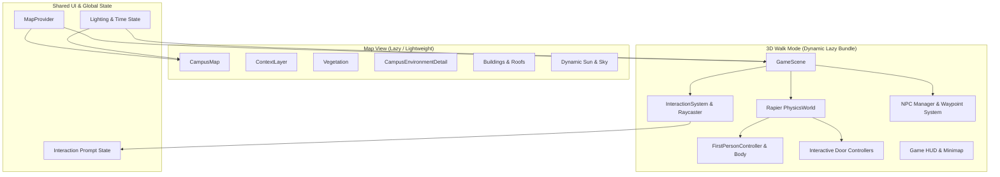

# ARCHITECTURE: Campus Simulation & 3D Walk Architecture

## 1. Executive Summary

Campus 3D Map is an interactive university campus visualization and simulation platform for Ajou University in Tashkent. This document defines the architectural blueprints for the interactive **Campus Simulation** environment encompassing:
- **Direction 1**: First-Person 3D Walk & Interaction (Rapier physics, Player Controller, Stairs, Doors, Raycast Interaction).
- **Direction 2**: Dynamic Time & Lighting System (24-hour cycle, Celestial Sun/Sky simulation, Night window illumination, Street lamps, Fountain lighting controller).
- **Direction 3**: Player Character & NPC Navigation System (Modular procedural low-poly characters, Stride/Idle animations, Waypoint navigation, LOD).
- **Mode Isolation & Resource Lifecycle**: Complete architectural isolation between Map View and 3D Walk mode to prevent bundle bloat and memory leaks.

---

## 2. Scale & Coordinate System Audit

From `docs/GEOMETRY_SPEC.md` and codebase verification:
- **Unit of Measurement**: 1 Three.js unit = 1.0 meter.
- **Axes Convention**:
  - `+X` = East
  - `+Y` = Up (Elevation)
  - `+Z` = South (North = `-Z`)
- **Campus Scale**:
  - Floor standard height: $3.6\text{ m}$ (slab thickness: $0.25\text{ m}$, clear interior height: $3.35\text{ m}$).
  - Standard doors: Width $1.0\text{ m}$ to $2.0\text{ m}$, Height $2.1\text{ m}$ to $2.4\text{ m}$.
  - Player character height: Total collider height $1.76\text{ m}$ (Capsule half-height $0.53\text{ m}$, radius $0.35\text{ m}$), Eye height: $1.65\text{ m}$.
  - Stairs: Step tread $\approx 0.30\text{ m}$, Step riser $\approx 0.15\text{ m}$, Incline ramp colliders angled at $\approx 24^\circ - 30^\circ$ for smooth step traversal without snagging.
  - Scale Consistency: Building footprints, connectors, amphitheater, and fountain conform to 1 unit = 1 meter.

---

## 3. High-Level System Architecture

---

## 4. Key Subsystem Specifications

### 4.1 Direction 1: First-Person 3D Walk & Interaction
- **Physics Engine**: `@react-three/rapier` running fixed-step continuous simulation.
- **Player Controller**:
  - RigidBody character controller with locked rotations (`lockRotations`).
  - Velocity lerping for smooth acceleration, deceleration, sprinting (Shift) and jump mechanics with ground raycasting.
  - Natural 2-axis head bobbing with landing compression.
- **Physical Environment**:
  - Ground terrain collider ($Y=0$).
  - Analytical box/hull colliders for building perimeters, amphitheater tiers, fountain basins, bridges, and tree trunks.
  - Staircase ramps matching visual risers to prevent snagging.
- **Interaction System**:
  - Camera-center raycaster with distance threshold ($\le 3.5\text{ m}$).
  - `Interactable` registry: Doors, Fountain controls, Waypoints.
  - Prompt overlay (e.g. `[E] Open Door`, `[E] Close Door`).
  - Interactive Doors: Hinge-anchored rotation ($0^\circ \leftrightarrow 95^\circ$), smooth angular lerp, dynamic collision sync.
  - Windows: High-quality double-sided architectural glass, static per project requirements.

### 4.2 Direction 2: Dynamic Time & Lighting System
- **24-hour Time Simulation**:
  - Normalized time $t \in [0, 24)$ with speed multiplier (real-time, 10x, 60x, or paused) and manual slider.
  - Sun azimuth & elevation formula calculating spherical celestial trajectory.
  - Sky turbidity, Rayleigh scattering, atmospheric fog, and directional light color/intensity interpolated smoothly across Night (00:00-05:00), Morning (06:00-10:00), Day (11:00-16:00), and Sunset (17:00-19:00).
- **Building Windows & Room Lighting**:
  - Emissive interior window illumination triggered dynamically based on time of day.
  - Deterministic pseudo-random seed per room for realistic scattered night office/classroom lights.
- **Street & Pathway Lighting**:
  - Automatically activates in evening/night; manual override in HUD.
  - Optimized localized point lights and emissive lantern heads.
- **Fountain Lighting**:
  - Dedicated controller: On/Off, color hue selection, intensity slider.
  - Night visual behavior reflecting upon water surface.

### 4.3 Direction 3: Player Character & NPC Navigation
- **Character Rendering**:
  - Modular procedural low-poly human models (torso, limbs, head, hair, styled attire).
  - Stride/walk animation system (harmonic swinging of arms and legs based on velocity).
  - Memory-efficient, zero CDN dependencies.
- **NPC Navigation System**:
  - Campus pedestrian network with interconnected waypoints along main avenues, courtyards, fountain promenades, and building entrances.
  - State machine: `Walking`, `Idle/Waiting`, `Turning`.
  - Collision-free navigation within defined walkable corridors.
  - Performance: Distance-based LOD (frustum check, distance culling $> 85\text{ m}$), limited active count.

---

## 5. Mode Isolation & Memory Management

1. **Lazy Loading**: `GameScene` and all Rapier physics/NPC dependencies are loaded via `React.lazy()` upon navigating to `/game` or clicking "3D Walk".
2. **Zero Overhead in Map View**: Standard map view imports zero physics or NPC loops.
3. **Clean Teardown**:
   - Exit walk mode removes Rapier world and cancels all `useFrame` physics subscriptions.
   - Pointer lock released.
   - Audio listeners reset.
   - Dom listeners cleaned up.
